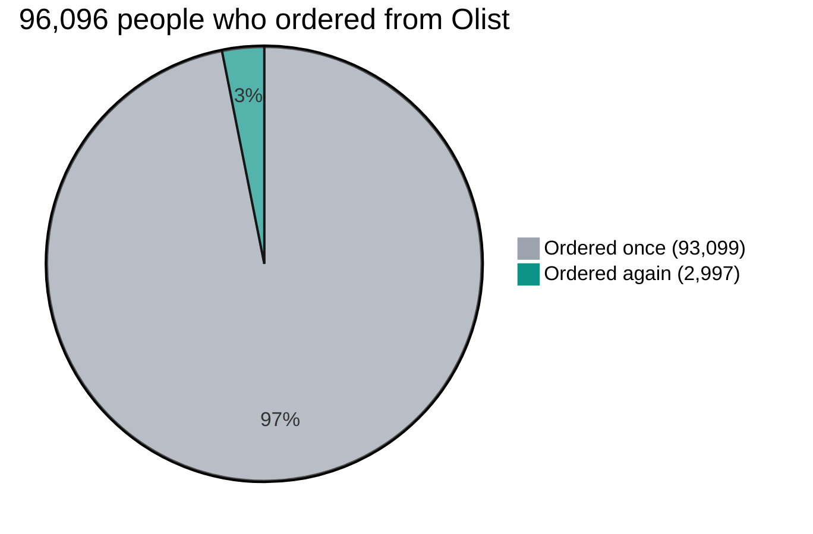
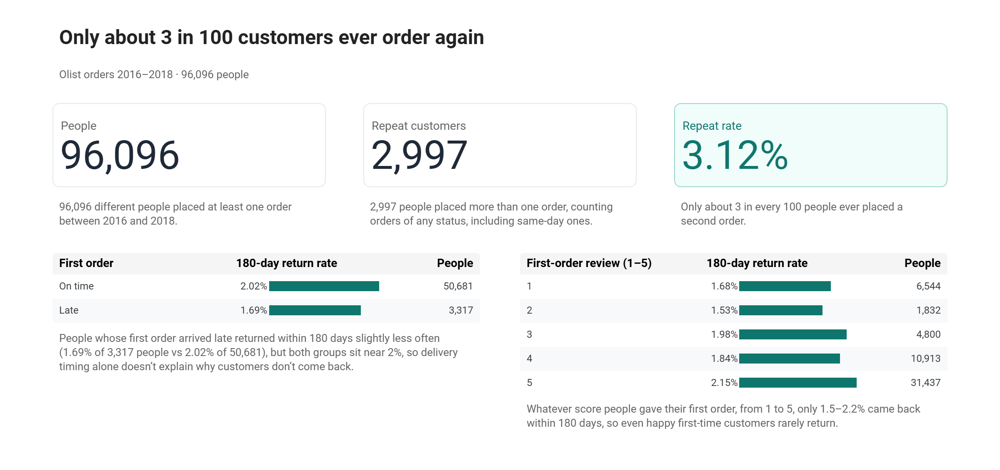
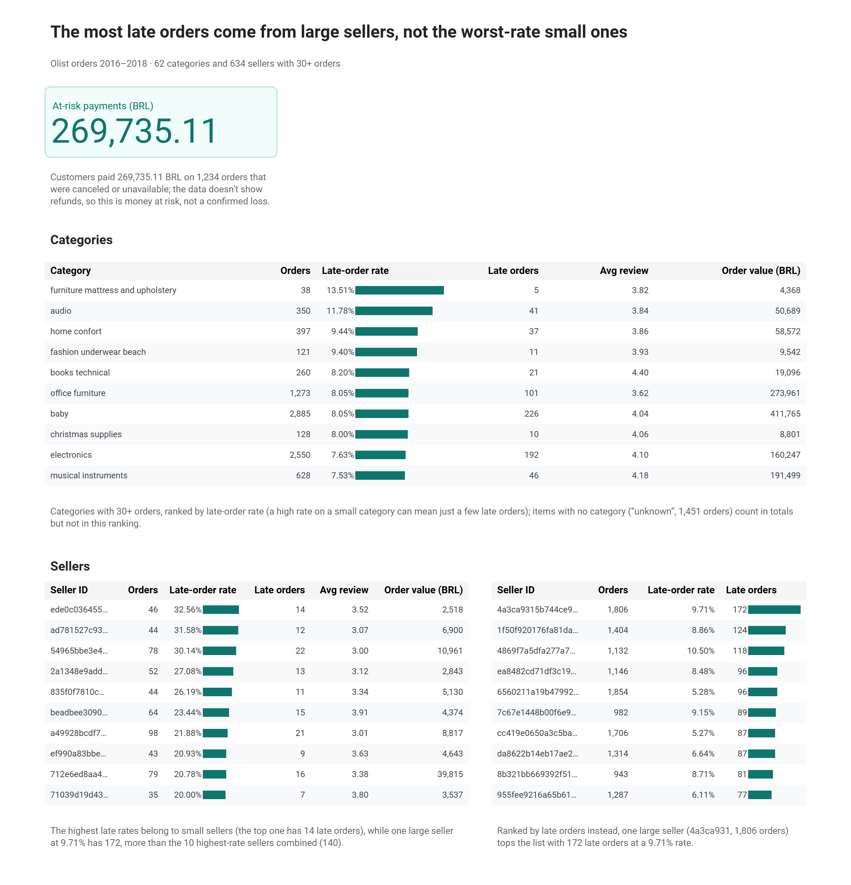
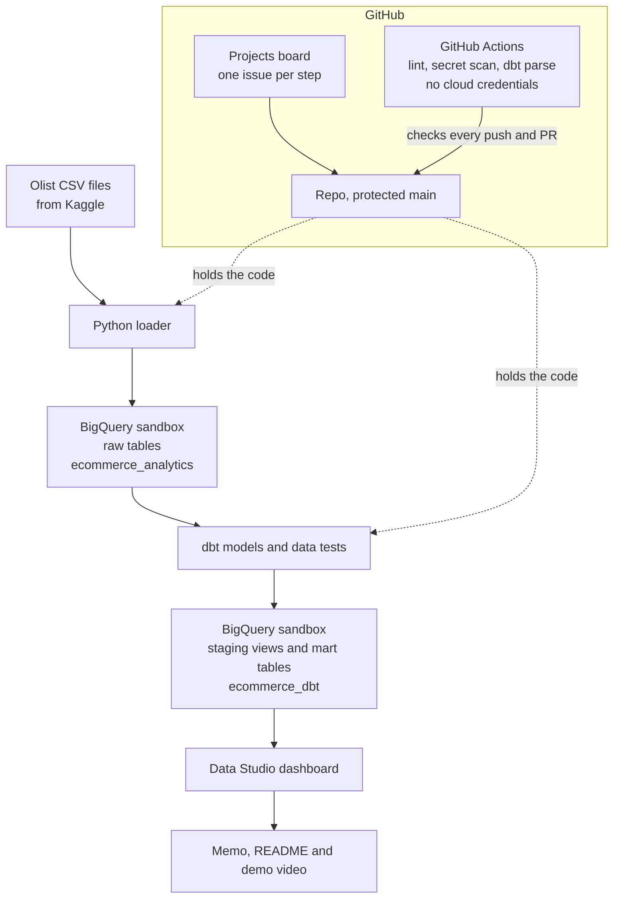

<picture>
  <source media="(prefers-color-scheme: dark)" srcset="docs/images/logo-dark.svg">
  
</picture>

*Why Olist customers don't come back*

[](https://datastudio.google.com/reporting/141992e1-ccfd-4563-8066-0bb982a5971b)
[](https://youtu.be/TfjrmG5UTJk)
[](https://www.kaggle.com/datasets/olistbr/brazilian-ecommerce)

I wanted to know where Olist, a Brazilian online marketplace, loses customers and money, and what it should fix first. Only about 3 in 100 people ever placed a second order (2,997 of 96,096), and among people I could follow for 180 days, about 2 in 100 came back whether their first order arrived late or on time. Olist should first test ways to win that second order, starting from today's 180-day return rate of 1.99%.

I built a data pipeline and a two-page dashboard (view-only, no sign-in needed) to answer that question.



## What I found

**Customers rarely come back, whatever their first experience.** Of 96,096 people, only 2,997 (3.12%) ever placed a second order. Among people followed for a full 180 days, about 2% came back, whether their first order arrived late (1.69%) or on time (2.02%), and whatever review score they gave it.

**The sellers with the most late orders are large ones, not the small sellers with the highest late rates (the top one has 14 late orders).** One large seller at 9.71% has 172 late orders, more than the 10 highest-rate sellers combined (140).

**Customers paid 269,735.11 BRL on 1,234 canceled or unavailable orders.** The data has no refunds, so this is money at risk, not a confirmed loss.

## What Olist should do first

**1. Test ways to win the second order.** For example, offer a follow-up deal to half of new customers and compare their 180-day return rate with the other half's. Today's rate, 1.99%, is the baseline.

**2. Start delivery work with the sellers that have the most late orders.** The top one alone has more late orders than the 10 highest-rate sellers combined (172 vs 140), so Olist should track the number of late orders as well as the rate.

**3. Find out what happened to the 269,735.11 BRL.** Check refund records for the 1,234 canceled and unavailable orders, starting with the 603 unavailable orders that have no items.

The [memo](docs/memo.md) has the full version.

## The dashboard



*The Customers page: of 96,096 people, only 2,997 ordered again, and the 180-day return rate stays near 2% whether the first order was late or on time, and whatever review score it got.*



*The Money page: 269,735.11 BRL paid on canceled or unavailable orders, which is money at risk, not a confirmed loss, and late-order rankings for categories and sellers.*

## How it works

A Python script loads the Olist CSV files into BigQuery as raw tables, exactly as delivered. dbt cleans them into staging views, builds mart tables (one row per person, order or item) and runs data tests on every build. The dashboard reads only the mart tables. GitHub holds the code, checks every change for lint errors and leaked secrets, and tracks each step on a project board.



[How it was built](docs/how-it-was-built.md) covers each milestone: what was planned, decided and checked.

## Limits

- The data covers 2016 to 2018-08-21. It shows patterns, not causes.
- It has no refunds, so payments on canceled orders can't be called losses.
- It has no seller names, only seller ID codes.

<details>
<summary><strong>Decisions worth noting</strong></summary>

- **No cloud credentials in GitHub.** The automated checks, including a dbt parse of every model, run without any access to BigQuery, so there's nothing to leak.
- **Every dashboard number has a written definition.** [docs/metrics.md](docs/metrics.md) gives each metric in plain words with its SQL, and three were checked against the raw data by hand.
- **Each order counts once.** Rates are per order or per person, never per item, so a three-item order doesn't count three times.
- **Everyone gets the same 180 days.** The return rate only includes people whose first order was at least 180 days before the data ends, so recent customers don't look as if they never came back.
- **Missing data is NULL, not 0.** An order with no review or no delivery date is left out of averages instead of dragging them down.
- **"Money at risk", not "loss".** Without refund records, payments on canceled orders can't honestly be called losses.
- **Rankings need 30 orders.** A seller with 2 bad orders can't top the list.

</details>

<details>
<summary><strong>Run it yourself</strong></summary>

This rebuilds every table in your own free BigQuery sandbox. Run every command from the repo's root folder.

1. **Install the tools.** [uv](https://docs.astral.sh/uv/) 0.13.5 (the Python package manager; it also installs Python 3.13 for you), [git](https://git-scm.com/) and the [Google Cloud CLI](https://cloud.google.com/sdk/docs/install) (`gcloud`).
2. **Clone the repo** and move into its folder:

   ```bash
   git clone https://github.com/baselnasser99/second-order.git
   cd second-order
   ```

3. **Install the project's libraries.** This creates a `.venv` folder with the exact versions in `uv.lock`, including dbt-core 1.12.6, dbt-bigquery 1.12.1, pre-commit and ruff:

   ```bash
   uv sync --locked
   ```

4. **Turn on the safety checks** (lint and secret scan before every commit):

   ```bash
   uv run pre-commit install
   ```

5. **Create a Google Cloud project** in the [Google Cloud console](https://console.cloud.google.com/) and open BigQuery. With no billing account it runs in sandbox mode: free, no credit card, and tables expire after 60 days. Note the project ID.
6. **Log in to Google Cloud.** This opens a browser and saves your login on your computer, so no key file is needed:

   ```bash
   gcloud auth application-default login
   ```

7. **Make your `.env` file.** Copy `.env.example` to a new file named `.env` and put your project ID after `GCP_PROJECT_ID=`. `.env` is gitignored, so it's never committed.
8. **Make your dbt profile.** Copy `dbt/profiles.example.yml` to `~/.dbt/profiles.yml` (on Windows, `C:\Users\<you>\.dbt\profiles.yml`), outside the repo. If you already have a `profiles.yml` there, add this project's profile to it instead of replacing the file. It reads the project ID from `.env`, so you don't need to edit it. Check the connection:

   ```bash
   uv run --env-file .env dbt debug --project-dir dbt
   ```

9. **Download the data.** Download the zip of the [Olist dataset from Kaggle](https://www.kaggle.com/datasets/olistbr/brazilian-ecommerce), unzip it, and put all 9 CSV files directly in `data/raw/`, not in a subfolder (gitignored, never committed).
10. **Create the raw dataset** `ecommerce_analytics`:

    ```bash
    uv run --env-file .env scripts/dataset.py create
    ```

11. **Load the CSVs** into raw tables. Each run replaces the tables, so running it again is safe:

    ```bash
    uv run --env-file .env scripts/load.py
    ```

12. **Check the row counts.** It prints one line per table and exits with code 1 if any table is missing or its count differs from its CSV:

    ```bash
    uv run --env-file .env scripts/check_counts.py
    ```

13. **Build and test the dbt models.** This creates the `ecommerce_dbt` dataset with the staging views and mart tables, and runs every data test:

    ```bash
    uv run --env-file .env dbt build --project-dir dbt
    ```

14. **Build the dashboard (by hand).** No script builds the dashboard. [docs/metrics.md](docs/metrics.md) section 5 lists every data source, chart, filter, label and caption, so you can rebuild it in Data Studio on your own `ecommerce_dbt` tables.

</details>

## Data and license

Data: the [Brazilian E-Commerce Public Dataset by Olist](https://www.kaggle.com/datasets/olistbr/brazilian-ecommerce) on Kaggle, licensed CC BY-NC-SA 4.0. It isn't included in this repo; "Run it yourself" explains how to download it.

Code: [MIT](LICENSE).
