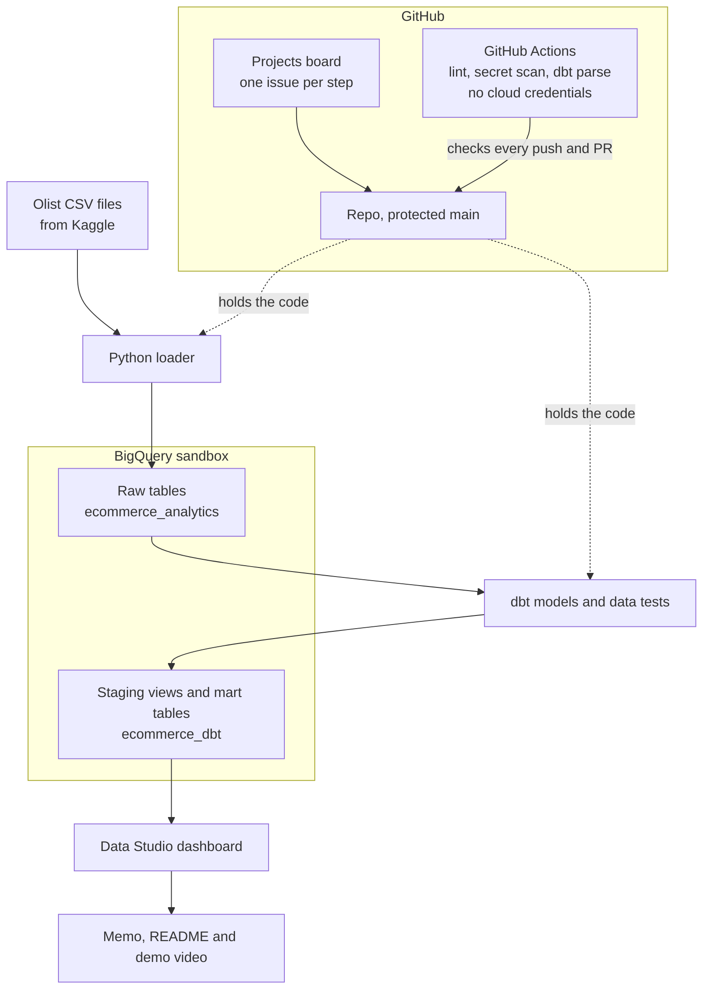

# Second Order

*Why Olist customers never come back: a cloud data pipeline on BigQuery and dbt.*

> Olist, a Brazilian online marketplace, wants to know **where it is losing customers and money**, and what to fix first.

**Status:** work in progress. See [ROADMAP.md](ROADMAP.md) for the plan and progress.

## How to load the data

1. Download the [Olist dataset from Kaggle](https://www.kaggle.com/datasets/olistbr/brazilian-ecommerce) and put all 9 CSV files directly in `data/raw/` (gitignored, never committed).
2. Make sure the `ecommerce_analytics` dataset exists (`uv run --env-file .env scripts/dataset.py create`).
3. Load every file into its own `raw_` table in BigQuery:

```bash
uv run --env-file .env scripts/load.py
```

Each run replaces the tables, so running it again is safe.

4. Check that every table has the same number of rows as its CSV:

```bash
uv run --env-file .env scripts/check_counts.py
```

It prints one line per table and exits with code 1 if any table is missing or its count differs.

## License

[MIT](LICENSE)

## How it works


